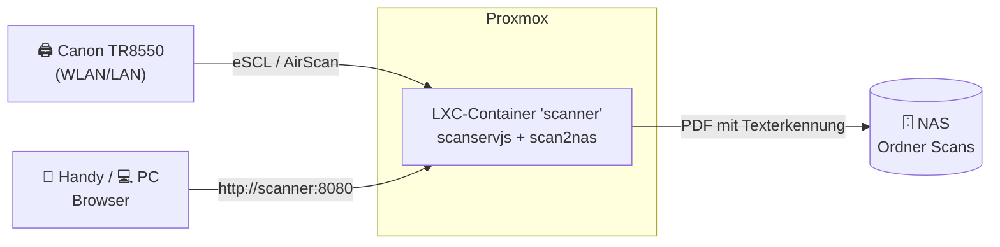

# scan2nas – Scans vom Canon TR8550 direkt aufs NAS

Hallo Björn! 👋

Dieses Projekt richtet auf deinem **Proxmox-Server** einen kleinen Container ein,
der die Scans von deinem **Canon PIXMA TR8550** abholt und als **durchsuchbares PDF**
auf deinem **NAS** ablegt. Du brauchst dafür keinen PC und keine Canon-Software.



## Was kann das?

| Weg | So geht's | Gut für |
|---|---|---|
| **Weboberfläche** | Im Browser `http://<container-ip>:8080` öffnen und auf **Scannen** tippen | Alltag, auch vom Handy aus |
| **Befehl** | `scan2nas scannen` oder `scan2nas scannen -q einzug` | Skripte, Automatisierung |
| **Einzug-Automatik** *(optional)* | Papier oben in den Einzug legen, nach 15 Sekunden wird gescannt | Viel Papier archivieren |

Und das passiert mit jedem Scan:

- Er wird zu einem **PDF** (mehrere Seiten aus dem Einzug landen in *einer* Datei).
- **Texterkennung (OCR)** auf Deutsch: Du kannst später im PDF nach Wörtern suchen.
  Schiefe und verkehrt herum eingelegte Seiten werden automatisch gerade gedreht.
- Die Datei landet auf dem NAS, sortiert nach Jahr und Monat:
  `Scans/2026/2026-11/Scan_2026-11-12_20-43-05.pdf`
- **Nichts geht verloren:** Ist das NAS gerade aus, wartet der Scan im Container
  und wird automatisch nachgeliefert, sobald das NAS wieder da ist.

## Was du brauchst

- Proxmox VE 8 oder 9 mit Internetzugang
- Den Canon TR8550 im selben Netzwerk, **mit fester IP-Adresse** (im Router einstellen)
- Ein NAS mit einer Freigabe (SMB oder NFS) und einem Benutzer, der dort schreiben darf

## Schnellstart (ca. 15 Minuten)

> Ausführlich mit Bildschirm-Beschreibungen: **[docs/01-vorbereitung.md](docs/01-vorbereitung.md)**
> und **[docs/02-installation.md](docs/02-installation.md)**

**1. Vorbereiten:** Scanner bekommt eine feste IP, auf dem NAS gibt es die Freigabe
`scans` und einen Benutzer `scanner`.

**2. Projekt auf den Proxmox-Host holen** (Shell des Hosts, als root):

```bash
apt install -y git
git clone https://github.com/developer2013/bjoerni.git
cd bjoerni
```

> Das Repository ist privat. Wie du Zugriff bekommst, steht in
> [docs/01-vorbereitung.md](docs/01-vorbereitung.md#4-zugriff-auf-dieses-repository).

**3. Einstellungen eintragen:**

```bash
cp proxmox/proxmox.conf.beispiel proxmox/proxmox.conf
nano proxmox/proxmox.conf      # Scanner-IP, NAS-Adresse, Freigabe, Benutzer, Passwort
```

**4. Alles einrichten lassen:**

```bash
./proxmox/lxc-erstellen.sh
```

Das Skript hängt das NAS ein, legt den Container an, installiert alles und macht
am Ende einen Selbsttest. Zum Schluss zeigt es dir die Adresse der Weboberfläche an.

**5. Testscan:** Weboberfläche öffnen, Blatt auf das Glas legen, **Scannen** klicken
und auf dem NAS im Ordner `Scans` nachschauen. 🎉

## Spickzettel

Die Befehle laufen **im Container**. Dorthin kommst du mit `pct enter <ID>` auf dem
Host oder über die Konsole in der Proxmox-Oberfläche.

```bash
scan2nas test                      # Prüft alles: Scanner, NAS, Programme
scan2nas scannen                   # Eine Seite vom Glas scannen
scan2nas scannen -q einzug         # Alle Seiten aus dem Einzug in ein PDF
scan2nas scannen -m grau -d 150    # Graustufen, 150 dpi (kleine Datei)
scan2nas status                    # Ist der Scanner bereit? Liegt Papier im Einzug?
scan2nas warteschlange             # Wartende Scans sofort aufs NAS schieben

nano /etc/scan2nas/scan2nas.conf   # Einstellungen ändern …
systemctl restart scan2nas         # … und übernehmen
journalctl -u scan2nas -f          # Meldungen live mitlesen
```

## Dokumentation

| Datei | Inhalt |
|---|---|
| [docs/01-vorbereitung.md](docs/01-vorbereitung.md) | Scanner-IP, NAS-Freigabe, Proxmox, Zugriff aufs Repository |
| [docs/02-installation.md](docs/02-installation.md) | Automatische und manuelle Installation, Updates, Deinstallation |
| [docs/03-benutzung.md](docs/03-benutzung.md) | Weboberfläche, Befehle, Einzug-Automatik, alle Einstellungen |
| [docs/04-fehlerbehebung.md](docs/04-fehlerbehebung.md) | Wenn etwas nicht klappt |

## Projektaufbau

```
bjoerni/
├── README.md                          ← du bist hier
├── AGENTS.md / CLAUDE.md              Hinweise für KI-Assistenten, die am Projekt mitarbeiten
├── proxmox/
│   ├── lxc-erstellen.sh               läuft auf dem Proxmox-Host: NAS, Container, Installation
│   └── proxmox.conf.beispiel          Vorlage für deine Einstellungen
├── installation/
│   └── installieren.sh                läuft im Container: Pakete, Scanner, Dienste
├── programm/
│   └── scan2nas.py                    das eigentliche Programm (Python, ohne Zusatzpakete)
├── konfiguration/
│   ├── scan2nas.conf.beispiel         alle Einstellungen mit Erklärung
│   └── scanservjs-config.local.js     verbindet die Weboberfläche mit dem NAS
├── systemd/
│   └── scan2nas.service               Hintergrunddienst im Container
├── tests/
│   └── test_scan2nas.py               automatische Tests (ohne Scanner/NAS lauffähig)
└── docs/                              ausführliche Anleitungen
```

## Wie funktioniert das technisch? (Kurzfassung)

- Der TR8550 spricht **eSCL** (auch „AirScan“ genannt), dasselbe Protokoll, das
  iPhones und Macs zum Scannen nutzen. Unter Linux übernimmt das der Treiber
  **sane-airscan**, eine Canon-Software ist nicht nötig.
- **[scanservjs](https://github.com/sbs20/scanservjs)** ist eine fertige
  Weboberfläche zum Scannen. Nach jedem Scan ruft sie `scan2nas uebernehmen` auf.
- **scan2nas** (in diesem Repository) erstellt die PDFs, macht die Texterkennung mit
  `ocrmypdf`, verwaltet die Warteschlange und kümmert sich um die Einzug-Automatik.
- Das **NAS wird auf dem Proxmox-Host eingehängt** und in den Container
  durchgereicht. Ein unprivilegierter Container darf Netzwerkfreigaben nämlich
  nicht selbst einhängen, und so bleibt er sicher abgeschottet.
