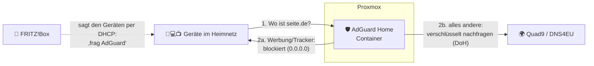

# AdGuard Home auf Proxmox – die komplette Anleitung

Hallo Björn! 👋

**AdGuard Home** blockiert Werbung, Tracker und gefährliche Seiten für **alle Geräte
in deinem Netzwerk** auf einmal: Handy, Smart-TV, Spielekonsole, Laptop. Auf den
Geräten musst du dafür nichts installieren. Es läuft als kleiner Container auf
deinem Proxmox und braucht kaum Ressourcen (1 Kern, 512 MB RAM).

## Der schnellste Weg: ein Befehl ⚡

In der Proxmox-Oberfläche → Knoten → **Shell**:

```bash
bash -c "$(curl -fsSL https://raw.githubusercontent.com/developer2013/bjoerni/main/adguard-home/einrichten.sh)"
```

Der Assistent erledigt die Kapitel 1, 2 und die eigenen Namen aus Kapitel 4 für dich:

- **findet deinen AdGuard-Container** (z. B. vom Community Script) oder legt einen
  neuen an
- macht eine DHCP-Adresse auf Wunsch zur **festen IP** und stellt die
  **Startreihenfolge** ein (AdGuard startet als Erstes)
- erledigt den **Einrichtungsassistenten**, falls noch offen (du wählst nur
  Benutzer und Passwort)
- stellt **verschlüsselte DNS-Server** (Quad9, DNS4EU), DNSSEC, Gerätenamen über
  den Router und die Ratenlimit-Ausnahme ein
- fügt **Sperrlisten** hinzu (HaGeZi Pro oder Normal, Threat Intelligence)
- legt **eigene Namen** an: `scanner.lan`, `drucker.lan`, `nas.lan`, `proxmox.lan`,
  `adguard.lan`. Was er im Netz findet, schlägt er vor
- erkennt eine **FRITZ!Box** und zeigt dir am Ende **genau die Werte**, die du dort
  eintragen musst, inklusive IPv6-Adresse

Nur die Umstellung im Router machst du selbst ([Kapitel 3](03-fritzbox-und-router.md)),
denn da soll niemand ungefragt in deiner FRITZ!Box herumschalten. Mehrfach ausführen
ist gefahrlos: Vorhandenes wird erkannt und nicht doppelt angelegt. Dein
AdGuard-Passwort wird nirgends gespeichert.

Wer verstehen will, was dabei passiert, oder lieber alles von Hand macht, liest
einfach die Kapitel unten.

## Wie funktioniert das?

Jedes Gerät fragt vor dem Laden einer Seite einen **DNS-Server**: „Welche Adresse
hat `werbung.example.com`?“ Normalerweise beantwortet das dein Router. Mit AdGuard
Home fragt jedes Gerät stattdessen deinen Container. Steht die Adresse auf einer
Sperrliste, antwortet er mit „gibt's nicht“. Die Werbung wird so gar nicht erst geladen.



## Die Kapitel

| # | Kapitel | Inhalt | Dauer |
|---|---|---|---|
| 1 | [Installation auf Proxmox](01-installation-proxmox.md) | Container per Community Script, feste IP, Startreihenfolge | 10 Min. |
| 2 | [Ersteinrichtung](02-ersteinrichtung.md) | Einrichtungsassistent, verschlüsselte DNS-Server, empfohlene Einstellungen | 15 Min. |
| 3 | [FRITZ!Box und andere Router](03-fritzbox-und-router.md) | Alle Geräte auf AdGuard umstellen (IPv4 **und** IPv6), Notfallplan | 15 Min. |
| 4 | [Filter, Geräte und eigene Namen](04-filter-und-clients.md) | Sperrlisten, Seiten freigeben, Kindersicherung, `scanner.lan` & Co. | 20 Min. |
| 5 | [Pflege: Updates und Backup](05-pflege-updates-backup.md) | Aktualisieren, sichern, Passwort vergessen, zweiter AdGuard | 10 Min. |
| 6 | [Fehlerbehebung](06-fehlerbehebung.md) | Internet geht nicht, Werbung kommt trotzdem, App funktioniert nicht | – |

## Die Kurzfassung für Eilige

1. **Proxmox → Knoten → Shell:**
   ```bash
   bash -c "$(curl -fsSL https://raw.githubusercontent.com/community-scripts/ProxmoxVE/main/ct/adguard.sh)"
   ```
   Mit erweiterten Einstellungen eine **feste IP** vergeben, z. B. `192.168.178.53/24`.
2. Im Browser `http://192.168.178.53:3000` öffnen und den Assistenten durchklicken.
   Weboberfläche auf **Port 80** lassen, Benutzer und Passwort festlegen.
3. **Einstellungen → DNS-Einstellungen:** verschlüsselte Upstream-Server eintragen
   (siehe [Kapitel 2](02-ersteinrichtung.md#upstream-dns-server)).
4. **FRITZ!Box:** *Heimnetz → Netzwerk → Netzwerkeinstellungen → IPv4-Einstellungen*
   → **Lokaler DNS-Server** = `192.168.178.53`. Dazu das Gleiche für IPv6
   (siehe [Kapitel 3](03-fritzbox-und-router.md)).
5. WLAN auf dem Handy einmal aus- und einschalten und in der AdGuard-**Übersicht**
   zusehen, wie die ersten Anfragen geblockt werden. 🎉

> **Die wichtigste Regel:** Wenn AdGuard Home nicht läuft, geht im ganzen Haus
> „das Internet nicht“, weil keine Adressen mehr aufgelöst werden. Lies deshalb den
> [Notfallplan](03-fritzbox-und-router.md#notfallplan-adguard-ist-aus) und stell in
> Proxmox die [Startreihenfolge](01-installation-proxmox.md#4-startreihenfolge-adguard-zuerst) ein.

## Beispielwerte in dieser Anleitung

Damit alle Kapitel zusammenpassen, nutzen wir durchgehend diese Werte.
Ersetz sie durch deine eigenen:

| Was | Beispiel | Bei dir |
|---|---|---|
| FRITZ!Box (Router) | `192.168.178.1` | |
| AdGuard-Home-Container | `192.168.178.53` | |
| scan2nas-Container (Scanner) | `192.168.178.60` | |
| Canon TR8550 | `192.168.178.50` | |
| Proxmox-Host | `192.168.178.5` | |

Die Endung `.53` für AdGuard ist Absicht. Port 53 ist der DNS-Port, so kann man sich
die Adresse gut merken.
